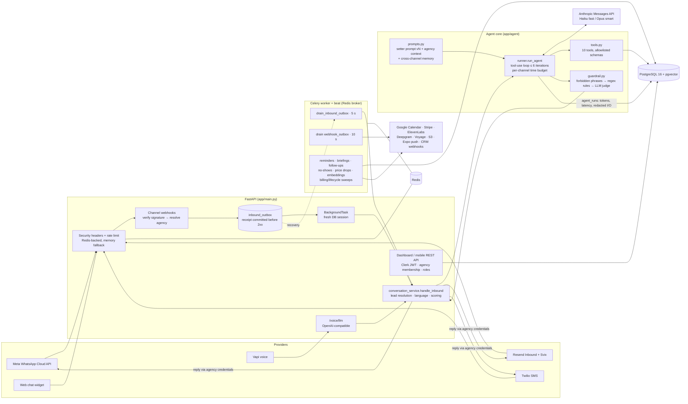

# selai: a multichannel AI setter for real-estate agencies

selai is a multi-tenant SaaS (formerly "Realtor AI"). It gives a real-estate agency an AI agent that answers buyers and sellers on **WhatsApp, e-mail, SMS, phone calls (Vapi) and an embeddable web chat**. The agent qualifies the lead, books the viewing, and hands the human agent a briefing.

> Built by Teferi ([@teferi26](https://github.com/teferi26)) with AI coding agents (commit trailers credit Claude models; a later branch is named `codex/…`). How one development wave was specified, split and verified is documented, with commit references, in [docs/AGENTIC_DEVELOPMENT.md](docs/AGENTIC_DEVELOPMENT.md).

## The problem

A small Spanish agency receives leads from portals (Idealista, Fotocasa, Habitaclia), WhatsApp, its website and the phone, often outside office hours. Slow replies lose leads. Qualifying them (budget, area, financing, urgency) and scheduling viewings takes a big share of an agent's day. selai answers in seconds, 24/7, and in the lead's language. It also keeps a human in control: any conversation can be taken over, and the AI hands off by itself when it should.

## What the agent does

- **Qualifies.** It asks for budget, operation (buy/rent), areas, bedrooms, must-haves and deal-breakers, and stores each answer as it learns it. A lead moves `new → engaged → qualified` automatically. An explainable 0–100 score and a temperature (hot/warm/cold) are kept on the lead.
- **Matches properties.** It searches the agency's own catalogue, filtering only `AVAILABLE` properties, and ranks them by pgvector cosine similarity over Voyage embeddings when there is free text. It can send a personalised property card with a "why it fits you" text.
- **Books viewings.** It checks the agency's business hours and existing visits, offers alternative slots on a collision, routes the visit to the nearest agent, creates a Google Calendar event when one is connected, and sends reminders 24 h and 1 h before.
- **Hands off.** `escalate_to_human` marks the conversation as handed off and pushes a three-line who/what/why summary to the team (mobile push and e-mail). A worker also generates an LLM **pre-visit briefing** for the human agent.
- **Other capabilities:** seller-lead capture, a mortgage quote, purchase costs by Spanish region (ITP), mortgage pre-approval, a "foreign buyer" mode (NIE, non-resident mortgages), detection of competitors fishing for information, 24h/72h follow-ups to silent leads, no-show detection, and price-drop alerts.
- **Languages:** the agent replies in the lead's language. Detection supports es/en/fr/ca/pt/de/it (`app/services/language.py`), and the product is sold for ES/EN/FR.
- **Disclosure:** the agent identifies itself as an AI in the first message of each conversation (EU AI Act art. 50, prompt v5+).

## Channels

| Channel | Inbound endpoint | Provider / notes |
|---|---|---|
| WhatsApp | `POST /webhooks/whatsapp` | Meta WhatsApp Cloud API. Per-agency app-secret signature check, voice notes transcribed with Deepgram, 12 s debounce. Replies are sent with the agency's own credentials. |
| E-mail | `POST /webhooks/email` | Resend Inbound, verified with Svix signatures. Parses portal lead e-mails (Idealista/Fotocasa/Habitaclia…). Replies carry threading headers and `Reply-To`. |
| SMS | `POST /webhooks/sms` | Twilio. Per-agency account, signature validated with that agency's token. |
| Voice | `POST /voice/llm`, `POST /webhooks/voice` | Vapi "custom LLM": an OpenAI-compatible endpoint that delegates to the same agent. Call lifecycle webhooks store the transcript and recording. Outbound calls to dormant leads. |
| Web chat | `POST /webhooks/web/{slug}/message`, `GET /webhooks/web/widget.js` | A vanilla JS widget that can be embedded anywhere. Rate-limited per IP and per session. |
| Google Business Profile | `POST /webhooks/google-business` | A scaffold. |

## Architecture

The diagram is drawn from `backend/app/main.py`, `app/api/*`, `app/services/inbound_outbox.py`, `app/services/conversation_service.py`, `app/agent/*`, `app/workers/celery_app.py` and `infra/docker-compose.yml`.



Key design decisions, each visible in the code:

- **Multi-tenant by `agency_id`.** Every agency-scoped router is guarded by an agency-membership dependency. A structural test fails the suite if a new `/agencies/{agency_id}` route lacks the guard (commit `f424d52`). Destructive and billing actions require the `OWNER` role.
- **Channel-agnostic core.** Each channel adapter normalises its input into an `InboundPayload`. The agent never knows which channel a message came from, except for per-channel style directives and time budgets.
- **Durable inbound.** Webhooks authenticate the request, write the receipt to `inbound_outbox`, commit, and only then answer the provider. A FastAPI `BackgroundTask` is the low-latency path, and a Celery beat task that runs every 5 s is the recovery path. Duplicates are dropped by external message id (a unique partial index). Outgoing CRM webhooks use a similar `webhook_outbox`, HMAC-signed, with SSRF guards and an auto-disable circuit breaker.
- **Observability of the LLM.** Every agent turn is written to `agent_runs`: model, prompt version, tokens (including cache reads and writes), latency, tool calls, guardrail verdict. PII is **redacted before persisting**. The system prompt uses Anthropic prompt caching.
- **No LLM framework.** The code uses the Anthropic SDK directly, without LangChain or LlamaIndex (a project convention in `CLAUDE.md`).

### Agent tool design (`backend/app/agent/tools.py`)

| Tool | Purpose |
|---|---|
| `search_properties` | Filtered catalogue search (`AVAILABLE` only, scoped by agency) with optional vector ranking |
| `save_lead_info` | Persist qualification data |
| `save_seller_lead` | Capture an owner who wants to sell or rent, and alert the agency |
| `schedule_visit` | Book a viewing, enforcing business hours and collisions, and suggest alternatives |
| `escalate_to_human` | Hand off with a reason (≤ 400 chars) and notify the team |
| `update_lead_temperature` | Hot/warm/cold, with a 48 h sticky "hot" |
| `send_property_card` | Personalised PDF/card plus an AI "why it fits" text |
| `mortgage_quote`, `purchase_costs` | Deterministic calculators (Spanish regional taxes) |
| `mortgage_preapproval` | Pre-approval hand-off flow |

Principles that show up in the implementation and its tests:

1. **The schema is a contract, and the executor enforces it again.** `save_lead_info` declares `additionalProperties: false`. Its executor still applies an exact field allowlist, coerces integers (`"320.000 EUR"` does not crash the flush) and restricts `operation` to `sale|rent`. Before this fix, a manipulative lead could set `status=won`, `consent_marketing=true` or even `agency_id` from the chat (finding *n7*, commit `dc955c5`, `tests/test_save_lead_info_allowlist.py`).
2. **Tools never raise into the model.** `execute_tool` returns `ERROR: …` strings, so the model can recover. The context (`AgentContext`) carries `agency_id`, `lead_id` and `conversation_id`, so a tool cannot reach another tenant.
3. **Untrusted text stays untrusted.** Per-agency free-text instructions and one-off conversation notes are wrapped so the customer's words cannot switch off the guardrail. Tests include prompt-injection cases (`tests/test_ai_control_adversarial.py`).
4. **Output is checked, not just prompted.** The agency's "never say" phrases are enforced on the generated text, including across the seam with the previous message. Then come deterministic rules, then a fail-open Haiku judge (`pass | rewrite | escalate`).
5. **Failure degrades to a human.** Timeouts, Anthropic 400s and exceptions produce a kind holding reply, and the agency is alerted (`AgentReply.failed`). History is normalised before the call (blank messages dropped, consecutive roles merged) because real inboxes broke Messages API invariants (commit `62384f9`).
6. **Model routing.** Haiku by default, Opus for hot or negotiating leads (`should_use_smart_model`).

## Repository layout

```
backend/     FastAPI app, agent, channel adapters, Celery workers, Alembic migrations (20), pytest suite
dashboard/   Next.js 16 (App Router) + Clerk: marketing site, onboarding, setup wizard, inbox, leads,
             calls, visits, catalogue, KPIs/funnel, offers, templates, billing, AI/voice/channel settings
mobile/      Expo / React Native app for the human agents: inbox, leads, agenda, takeover, push
infra/       docker-compose (Postgres+pgvector, Redis, API, worker, beat)
docs/        roadmap/backlogs (specs), launch guide, runbooks, AGENTIC_DEVELOPMENT.md
```

Production ran on Railway (separate web, worker and beat services: `backend/railway*.json`) and Vercel for the dashboard. Errors go to Sentry, configured with `send_default_pii=False`.

## Testing

```bash
cd backend
pip install -e ".[dev]"
pytest -q                     # whole suite; no Postgres/Redis needed
ruff check app tests
```

- **Size:** 131 test modules in `backend/tests/`, with **2,128 `test_` functions** (static count of `def test_*`). With `@pytest.mark.parametrize` (used in 45 modules), the latest recorded run (2026-09-02, in the project's private pre-launch audit notes) collected **2,480 tests at 83.23% line coverage**. That run was not repeated when this README was written; the static count above is the directly checkable figure.
- **What is covered:**
  - Agent: tool contracts, the Anthropic message shape, smart-model routing, prompt/date injection, guardrail and forbidden phrases, adversarial prompt injection.
  - Channels: WhatsApp signature/media/debounce, the e-mail parser and Svix, SMS, voice routing, inbound dedup and outbox.
  - Tenancy, auth and roles: membership guards, JWKS refresh, invitations, offices.
  - Billing: Stripe webhooks, checkout, plan change, dunning, plan gating.
  - Workers and lifecycle: follow-ups, reminders, retention, GDPR export/erasure.
  - Legal documents, PII redaction, and SSRF guards.
- **Testing style:**
  - External providers (Anthropic, Meta, Resend, Twilio, Vapi, Stripe, Google) are faked at the client boundary. DB access goes through fake sessions or "World" fixtures, so CI needs no services.
  - 11 `*_adversarial.py` modules attack each feature track after it is built (cross-tenant access, replayed or out-of-order webhooks, injection).
  - `tests/test_cross_layer_contracts.py` reads the dashboard's and the mobile app's TypeScript and fails when a shared constant drifts from the backend. Examples: the weekday convention, the annual-price formula, and "no screen promises a price other than the one charged".
- **CI** (`.github/workflows/ci.yml`):
  - Backend: `pip check`, `pip-audit`, ruff, pytest with `--cov-fail-under=80`, plus `pytest ops`.
  - Dashboard: `npm audit`, lint, typecheck, build.
  - Mobile: `npm audit`, `expo install --check`, an auth-config validation, typecheck.
  - CodeQL runs separately (`.github/workflows/codeql.yml`).
- **Gaps:** the web and mobile apps have no E2E tests.

## Local setup

Requirements: Docker, Python 3.12, Node 24 (dashboard) / Node ≥ 22.13 (mobile).

```bash
# 1. Config: every value in the example is empty or a local default
cp backend/.env.example backend/.env
#    set at least ANTHROPIC_API_KEY. Without CLERK_JWKS_URL and with APP_ENV=development,
#    the API accepts the X-Dev-User / X-Dev-Email headers as dev auth (never in production).

# 2. Infra
cd infra && docker compose up -d postgres redis && cd ..

# 3. Backend
cd backend
pip install -e ".[dev]"
alembic upgrade head
python -m app.scripts.seed_demo        # demo agency "piloto", owner@piloto.test
uvicorn app.main:app --reload          # http://localhost:8000/docs (disabled in production)

# 4. Workers (another shell)
celery -A app.workers.celery_app worker --loglevel=info
celery -A app.workers.celery_app beat   --loglevel=info

# 5. Dashboard
cd ../dashboard && cp .env.example .env.local    # DEV_USER_EMAIL=owner@piloto.test
npm install && npm run dev                       # http://localhost:3000

# 6. Mobile (optional)
cd ../mobile && cp .env.example .env && npm install && npx expo start
```

Alternatively, `cd infra && docker compose up` starts Postgres, Redis, the API, the worker and beat together.

Channel-specific setup (Meta app and webhook, Resend inbound, Vapi assistant, Twilio number, widget snippet) is described step by step in Spanish in [docs/README.es.md](docs/README.es.md).

## Status and honesty notes

- The product was deployed (selai.es, Railway and Vercel) with a pilot agency in view. At the time of the last internal audit (2026-09-02), the production backend was inactive.
- `CLAUDE.md` describes the original plan. Some of its details are outdated (for example "Next.js 14"; the dashboard is on Next.js 16.3).
- `docs/ROADMAP.md` (the 100-item roadmap) and `docs/mejoras-ux*.md` (backlogs v1/v2) are the working specs. ✅ marks the items that were implemented.
